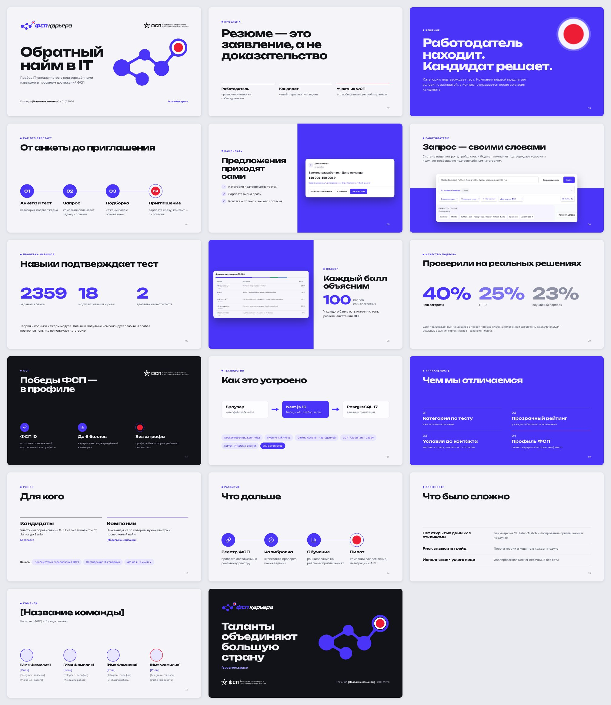

# Презентация проекта

Финальная презентация ФСП Карьеры для ЛЦТ 2026: 17 слайдов 16:9 в айдентике проекта. Структура следует шаблону ЛЦТ: титульный слайд, задача и решение, продукт, техническая часть, уникальность, рынок, планы развития, сложности и команда.



| Файл | Что внутри |
|---|---|
| [fsp-career-presentation.pdf](fsp-career-presentation.pdf) | Готовая презентация для сдачи и показа |
| [source/](source/) | Исходники: `deck.json` (порядок, разделы, шрифты) и по одному HTML-файлу на слайд; заметки спикера — в `<aside>` |
| [assets/](assets/) | Фрагменты скриншотов продукта, светлый логотип и логотипы ФСП из шаблона ЛЦТ; основной логотип и знак берутся из `public/brand/` |
| [build.mjs](build.mjs) | Сборка PDF и превью локальным Chrome |

## Перед сдачей

Заполните значения в квадратных скобках: название команды (титульный слайд, «Команда» и финальный), капитан, город, участники с ролями и контактами, модель монетизации на слайде «Рынок». В заметках к слайдам «Сложности» и «Команда» добавьте историю команды. После правок пересоберите PDF.

## Сборка

```sh
npm i --no-save playwright-core
node docs/presentation/build.mjs
```

Нужны установленный Google Chrome (канал меняет `CHROME_CHANNEL`) и доступ к Google Fonts для шрифтов Unbounded и Golos Text. Скрипт перезаписывает `fsp-career-presentation.pdf` и `preview.jpg`; флаг `--png=<папка>` дополнительно сохраняет PNG каждого слайда.

## Откуда цифры

Числа на слайдах взяты из документации репозитория: банк заданий — [question-bank-review.md](../question-bank-review.md), формула и пороги грейдов — [scoring.md](../scoring.md), веса рейтинга — [README](../../README.md#как-работает-рейтинг), проверка подбора на ML TalentMatch — [matching-benchmark.md](../matching-benchmark.md). Детали и оговорки, которые не поместились на слайды, вынесены в заметки спикера. Скриншоты сняты с локальной копии на демонстрационных данных.

## Формат исходников

Слайды хранятся в формате Slides-артефакта Claude: каждый `<section>` — холст 1920×1080 со стилями в атрибуте `style`. Изображения ссылаются на загруженные файлы как `/_blob/<id>`, а `source/assets.json` сопоставляет эти ссылки с файлами репозитория. Редактируемая версия презентации живёт в claude.ai у автора; правки оттуда переносятся в `source/`, после чего PDF пересобирается.
